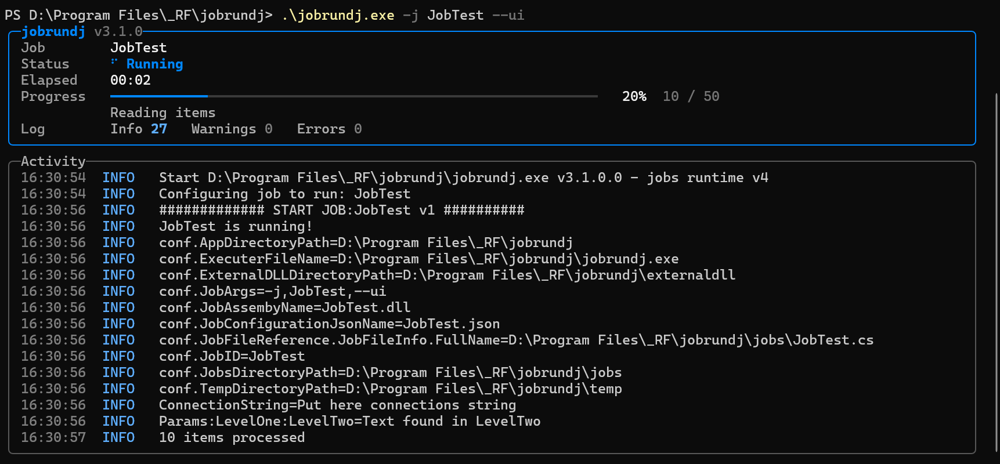
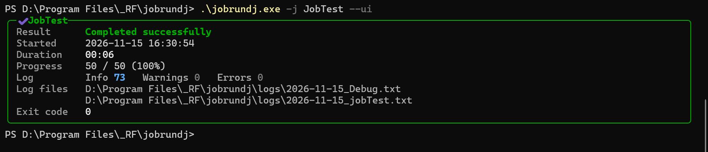

# jobrundj

[English](README.md) | [Italiano](README.it.md) | [Español](README.es.md) | [Français](README.fr.md) | **Deutsch**

ist ein Werkzeug zum Ausführen von C#-Skripten.

Es ist in .NET 10 geschrieben und läuft unter Windows, Linux und macOS.


- Die Skripte heißen Jobs. Jeder Job ist eine .cs-Datei im Ordner .\jobs.
- Der Job muss eine Klasse enthalten, die von jobmodeldj.jobs.Job erbt.
- Der Code des Skripts wird implementiert, indem die Methode Execute überschrieben wird.
- Weitere Assemblies, von denen der Job abhängt, werden in der ersten Zeile zwischen den Tags jobrundjReferencedAssemblies angegeben.
- Die Variable l ist ein NLog.Logger.
- Das Argument conf enthält die Konfigurationsreferenzen.
- Eine Datei [JobName].json kann hinzugefügt werden, um eigene Konfigurationen zu speichern (Verbindungszeichenfolgen usw.).
- Der Ordner docs/JobExamples enthält einige Test-Jobs.

```c#
//<jobrundjReferencedAssemblies></jobrundjReferencedAssemblies>
using System;
using System.Threading;
using NLog;
using jobmodeldj.Model;

namespace jobmodeldj.jobs
{
    class JobTest : Job
    {
        public override int JobRuntimeVersion { get { return 4; } }
        public int Version { get { return 1; } }

        public override void Execute(JobConfiguration conf)
        {
            try
            {
                l.Info("{0} is running!", this.JobID);
                l.Info("conf.AppDirectoryPath={0}", conf.AppDirectoryPath);
                l.Info("conf.ExecuterFileName={0}", conf.ExecuterFileName);
                l.Info("conf.ExternalDLLDirectoryPath={0}", conf.ExternalDLLDirectoryPath);
                l.Info("conf.JobArgs={0}", string.Join(',',conf.JobArgs));
                l.Info("conf.JobAssembyName={0}", conf.JobAssembyName);
                l.Info("conf.JobConfigurationJsonName={0}", conf.JobConfigurationJsonName);
                l.Info("conf.JobFileReference.JobFileInfo.FullName={0}", conf.JobFileReference.JobFileInfo.FullName);
                l.Info("conf.JobID={0}", conf.JobID);
                l.Info("conf.JobsDirectoryPath={0}", conf.JobsDirectoryPath);
                l.Info("conf.TempDirectoryPath={0}", conf.TempDirectoryPath);
                l.Info("ConnectionString={0}", conf.Json?["ConnectionString"]);
                l.Info("Params:LevelOne:LevelTwo={0}", conf.Json?["Params:LevelOne:LevelTwo"]);

                // Progress-Demo: "jobrundj -j JobTest --ui" ausführen, um den Fortschrittsbalken zu sehen.
                // Progress(aktuell, gesamt, Meldung) bewegt den Balken des Dashboards und schreibt
                // "Progress 25/50 (50%) ..." ins Log (höchstens einmal pro Prozentpunkt oder alle 2 Sekunden).
                int total = 50;
                for (int i = 1; i <= total; i++)
                {
                    Thread.Sleep(100); // simuliert die Arbeit an einem Element
                    Progress(i, total, i <= total / 2 ? "Reading items" : "Writing items");
                    if (i % 10 == 0) l.Info("{0} items processed", i);
                }

                //
                //TODO hier deinen Code schreiben..
                //
            }
            catch (Exception ex)
            {
                l.Error("errore {0} - {1}", JobID, ex.Message);
                throw ex;
            }
            finally
            {
                l.Info("end {0}", JobID);
            }
        }

    }
}
```

Ausführung von JobTest mit dem Live-Dashboard in Windows Terminal (`jobrundj.exe -j JobTest --ui`), während der Ausführung und am Ende:





# jobrundj.exe / jobrundj.dll

jobrundj ist die Konsolenanwendung, die einen Job ausführt.

Unter Windows:

**`jobrundj.exe`** **`-j`** `JobName`  

Unter Linux oder Mac OS:

**`dotnet jobrundj.dll`** **`-j`** `JobName`  


# Live-Dashboard

Füge `--ui` hinzu, um die Ausführung in einem farbigen Konsolen-Dashboard zu verfolgen: Status, verstrichene Zeit, Fortschrittsbalken, Anzahl der Warnungen und Fehler und die letzten Log-Meldungen. Am Ende zeigt eine Zusammenfassung Ergebnis, Dauer, Warnungen und Fehler sowie die Log-Dateien.

Unter Windows:

**`jobrundj.exe`** **`-j`** `JobName` **`--ui`**

Unter Linux oder Mac OS:

**`dotnet jobrundj.dll`** **`-j`** `JobName` **`--ui`**

Der Fortschrittsbalken erscheint, wenn der Job `Progress(aktuell, gesamt, "Meldung")` aufruft, zum Beispiel `Progress(i, zeilen.Count, "Zeilen exportieren")` in einer Schleife. `Progress` schreibt außerdem eine Log-Zeile (`Progress 680/1000 (68%) Zeilen exportieren`), höchstens einmal pro Prozentpunkt oder alle 2 Sekunden, und kann daher bei jedem Element aufgerufen werden.

`--ui` benötigt ein interaktives Terminal (Windows Terminal, das macOS-Terminal, jedes Linux-Terminal). Ist die Ausgabe umgeleitet oder wird der Job geplant ausgeführt, wird die Option ignoriert und jobrundj schreibt das Log wie gewohnt auf die Konsole. Die Log-Dateien werden immer geschrieben.

Um einen Job per Doppelklick zu starten, erstelle eine Desktop-Verknüpfung mit `new-shortcut.ps1` (Windows) oder `new-shortcut.sh` (macOS / Linux), die in der Distribution enthalten sind: siehe den [Leitfaden für Job-Entwickler](jobrundj/dist/DEVELOPER_GUIDE.md#desktop-shortcuts).


# Jobs in Visual Studio Code debuggen

Das Distributionspaket enthält einen einsatzbereiten Ordner `.vscode`. Die vollständige Anleitung (Debug-Konfigurationen, Job-Argumente, Fehlerbehebung) steht im [Leitfaden für Job-Entwickler](jobrundj/dist/DEVELOPER_GUIDE.md#debugging-in-vs-code).

1. Installiere [VS Code](https://code.visualstudio.com/) und die Erweiterung **C#** (`ms-dotnettools.csharp`).
2. Öffne in VS Code den jobrundj-Ordner (den Ordner mit `jobrundj.exe` / `jobrundj.dll`).
3. Öffne die Job-Datei in `jobs`, setze Haltepunkte und drücke **F5** (Konfiguration *Debug current job file*).

Weitere Konfigurationen:

- *Debug current job file (with arguments)*: fragt nach den Argumenten für den Job.
- *Debug job by name*: fragt nach dem Namen des Jobs.
- *Attach to jobrundj*: starte `jobrundj -j JobName --debug` (wartet auf einen Debugger) und hänge dich dann an den Prozess an.

Befehlszeilenoptionen:

- `-j`, `--job` auszuführender Job (erforderlich)
- `-d`, `--jobsdir` Ordner mit den Jobs (Standard: `jobs` neben der ausführbaren Datei)
- `--debug` kompiliert den Job mit Debug-Symbolen und wartet, bis sich ein Debugger anhängt
- `--ui` zeigt ein Live-Dashboard mit Fortschritt und am Ende eine Zusammenfassung (siehe [Live-Dashboard](#live-dashboard))
- `--pause` wartet vor dem Schließen des Fensters auf einen Tastendruck (nur interaktive Konsole), nützlich für Desktop-Verknüpfungen

`jobs/jobs.csproj` wird nur von VS Code für IntelliSense verwendet (erfordert das .NET SDK); zum Ausführen der Jobs wird es nicht benötigt.

# Installation (nur Jobs ausführen)

Dieser Abschnitt richtet sich an alle, die Jobs nur **ausführen**, zum Beispiel auf einem Server. VS Code und das .NET SDK werden nicht benötigt.

1. Installiere die [.NET 10 Runtime](https://dotnet.microsoft.com/download/dotnet/10.0) (die *.NET Runtime* genügt).
2. Lade `jobrundj-<version>.zip` von der [Release-Seite](https://github.com/renzfe/jobrundj/releases) herunter und entpacke es. Verschiebe den Inhalt des Ordners `jobrundj-<version>` in den Installationsordner, zum Beispiel `C:\jobrundj` oder `/opt/jobrundj`.
3. Kopiere die erhaltenen Job-Dateien (`MeinJob.cs` und, falls vorhanden, `MeinJob.json`) in den Ordner `jobs`. Zusätzliche .dll-Dateien, die die Jobs benötigen, kommen in `externaldll`.
4. Führe den Job aus:
   - Windows: `C:\jobrundj\jobrundj.exe -j MeinJob`
   - Linux / macOS: `dotnet /opt/jobrundj/jobrundj.dll -j MeinJob`
5. Prüfe das Ergebnis: Exit-Code `0` = Erfolg, `1` = Fehler. Die Logs werden in den Ordner `logs` geschrieben; Format und Ziel lassen sich in `NLog.config` ändern.

Um einen Job automatisch auszuführen, plane den Befehl ein:

- Windows (Aufgabenplanung), täglich um 06:00:
  `schtasks /Create /TN "jobrundj MeinJob" /TR "C:\jobrundj\jobrundj.exe -j MeinJob" /SC DAILY /ST 06:00`
- Linux / macOS (crontab), täglich um 06:00:
  `0 6 * * * dotnet /opt/jobrundj/jobrundj.dll -j MeinJob`

Der Ordner `.vscode`, die Datei `jobs/jobs.csproj`, der Leitfaden `DEVELOPER_GUIDE.md` und die KI-Kontextdateien `AGENTS.md` / `CLAUDE.md` werden nur für die Entwicklung von Jobs benötigt und können ignoriert werden.

**Aktualisierung auf eine neue Version:** kopiere den Inhalt des neuen Ordners `jobrundj-<version>` über den Installationsordner. Deine Jobs in `jobs` und die .dll-Dateien in `externaldll` bleiben erhalten; falls du `NLog.config` angepasst hast, überschreibe sie nicht.

# Jobs entwickeln

🛠️ **Wenn du Jobs schreibst oder debuggst, folge dem [Leitfaden für Job-Entwickler](jobrundj/dist/DEVELOPER_GUIDE.md)** (auf Englisch). Er erklärt, wie man VS Code einrichtet, einen Job schreibt und Schritt für Schritt debuggt, und enthält ein vollständiges Beispiel (ein Job, der das Ergebnis einer Datenbankabfrage in eine CSV-Datei exportiert). Derselbe Leitfaden ist als `DEVELOPER_GUIDE.md` im Distributionspaket enthalten.

# Versionshinweise

## v3.1.0 Veröffentlichungsdatum: 2026-11-15

- Option `--ui`: Live-Dashboard in der Konsole (Fortschritt, Log-Zähler, letzte Meldungen) und Zusammenfassung am Ende
- Methode `Progress(aktuell, gesamt, Meldung)` in `Job`, um den Fortschritt des Jobs zu melden
- Option `--pause`: wartet vor dem Schließen des Fensters auf einen Tastendruck
- Skripte `new-shortcut.ps1` / `new-shortcut.sh` zum Erstellen von Desktop-Verknüpfungen, die einen Job mit dem Dashboard starten

## v3.0.0 Veröffentlichungsdatum: 2026-11-15

- Debuggen von Jobs in Visual Studio Code (Haltepunkte in den .cs-Dateien der Jobs)
- Neue Befehlszeilenoptionen: `-d`/`--jobsdir` und `--debug`
- Das Distributionspaket enthält die Debug-Konfigurationen in `.vscode`, `jobs/jobs.csproj` für IntelliSense und einen Leitfaden für Job-Entwickler
- Skript `build-dist.ps1` zum Erstellen des Distributionspakets

## v2.3.0 Veröffentlichungsdatum: 2026-11-14

- Aktualisierung auf dotnet 10.0

## v2.1.0 Veröffentlichungsdatum: 2023-01-07

- Einführung der Job-Version, um einzelne Jobs zu versionieren

## v2.0.0 Veröffentlichungsdatum: 2023-12-29

- Aktualisierung auf dotnet 8.0
- Job-Runtime-Version v4


## v1.5.0 Veröffentlichungsdatum: 2023-04-25

- Aktualisierung auf dotnet 7.0
- Job-Runtime-Version v3


## v1.3.0 Veröffentlichungsdatum: 2022-11-13

- Erweitere die Klasse Options, um eigene Argumente in deinem Job zu implementieren


## v1.1.0 Veröffentlichungsdatum: 2022-11-06

- Erste stabile Version.


---
Das Projekt steht unter der [MIT](LICENSE)-Lizenz.
