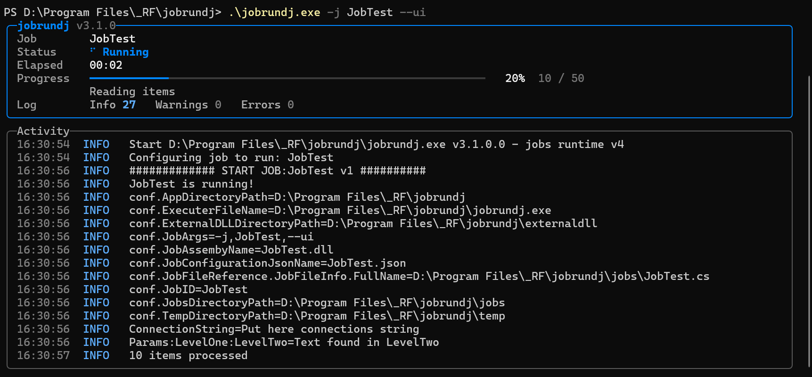
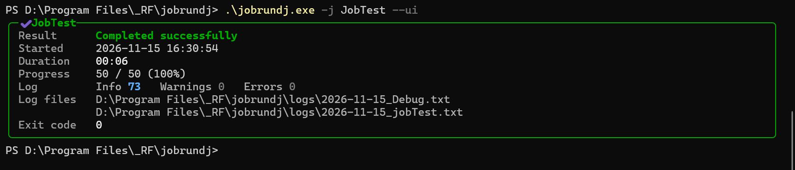

# jobrundj

[English](README.md) | [Italiano](README.it.md) | **Español** | [Français](README.fr.md) | [Deutsch](README.de.md)

es una herramienta para ejecutar scripts C#.

Está escrita y se ejecuta en .NET 10.0 en Windows, Linux y Mac OS.


- Los scripts se llaman jobs. Cada job es un archivo .cs guardado en la carpeta .\jobs.
- El job debe contener una clase que extienda jobmodeldj.jobs.Job.
- El código del script se implementa sobrescribiendo el método Execute.
- Cualquier otro assembly del que dependa el job debe declararse en la primera línea, entre las etiquetas jobrundjReferencedAssemblies
- La variable l es un NLog.Logger
- El argumento conf contiene las referencias de configuración
- Se puede añadir un archivo [NombreJob].json para guardar configuraciones personalizadas (cadenas de conexión, etc.)
- La carpeta docs/JobExamples contiene algunos jobs de prueba

```c#
//<jobrundjReferencedAssemblies></jobrundjReferencedAssemblies>
using System;
using System.Threading;
using NLog;
using jobmodeldj.Model;

namespace jobmodeldj.jobs
{
    class JobTest : Job
    {
        public override int JobRuntimeVersion { get { return 4; } }
        public int Version { get { return 1; } }

        public override void Execute(JobConfiguration conf)
        {
            try
            {
                l.Info("{0} is running!", this.JobID);
                l.Info("conf.AppDirectoryPath={0}", conf.AppDirectoryPath);
                l.Info("conf.ExecuterFileName={0}", conf.ExecuterFileName);
                l.Info("conf.ExternalDLLDirectoryPath={0}", conf.ExternalDLLDirectoryPath);
                l.Info("conf.JobArgs={0}", string.Join(',',conf.JobArgs));
                l.Info("conf.JobAssembyName={0}", conf.JobAssembyName);
                l.Info("conf.JobConfigurationJsonName={0}", conf.JobConfigurationJsonName);
                l.Info("conf.JobFileReference.JobFileInfo.FullName={0}", conf.JobFileReference.JobFileInfo.FullName);
                l.Info("conf.JobID={0}", conf.JobID);
                l.Info("conf.JobsDirectoryPath={0}", conf.JobsDirectoryPath);
                l.Info("conf.TempDirectoryPath={0}", conf.TempDirectoryPath);
                l.Info("ConnectionString={0}", conf.Json?["ConnectionString"]);
                l.Info("Params:LevelOne:LevelTwo={0}", conf.Json?["Params:LevelOne:LevelTwo"]);

                // Demo de Progress: ejecuta "jobrundj -j JobTest --ui" para ver la barra de progreso.
                // Progress(actual, total, mensaje) mueve la barra del panel y escribe
                // "Progress 25/50 (50%) ..." en el log (como máximo una vez por punto porcentual o cada 2 segundos).
                int total = 50;
                for (int i = 1; i <= total; i++)
                {
                    Thread.Sleep(100); // simula el trabajo sobre un elemento
                    Progress(i, total, i <= total / 2 ? "Reading items" : "Writing items");
                    if (i % 10 == 0) l.Info("{0} items processed", i);
                }

                //
                //TODO escribe aquí tu código..
                //
            }
            catch (Exception ex)
            {
                l.Error("errore {0} - {1}", JobID, ex.Message);
                throw ex;
            }
            finally
            {
                l.Info("end {0}", JobID);
            }
        }

    }
}
```

Ejecución de JobTest con el panel en tiempo real en Windows Terminal (`jobrundj.exe -j JobTest --ui`), durante la ejecución y al final:





# jobrundj.exe / jobrundj.dll

jobrundj es la aplicación de consola que ejecuta un job.

En Windows:

**`jobrundj.exe`** **`-j`** `NombreJob`  

En Linux o Mac OS:

**`dotnet jobrundj.dll`** **`-j`** `NombreJob`  


# Panel en tiempo real

Añade `--ui` para seguir la ejecución en un panel de consola en color: estado, tiempo transcurrido, barra de progreso, número de advertencias y errores y los últimos mensajes del log. Al final, un resumen muestra el resultado, la duración, las advertencias y errores y los archivos de log.

En Windows:

**`jobrundj.exe`** **`-j`** `NombreJob` **`--ui`**

En Linux o Mac OS:

**`dotnet jobrundj.dll`** **`-j`** `NombreJob` **`--ui`**

La barra de progreso aparece cuando el job llama a `Progress(actual, total, "mensaje")`, por ejemplo `Progress(i, filas.Count, "Exportando filas")` dentro de un bucle. `Progress` también escribe una línea de log (`Progress 680/1000 (68%) Exportando filas`), como máximo una vez por punto porcentual o cada 2 segundos, así que se puede llamar en cada elemento.

`--ui` necesita un terminal interactivo (Windows Terminal, el Terminal de macOS, cualquier terminal de Linux). Si la salida está redirigida o el job está programado, la opción se ignora y jobrundj escribe el log en la consola como siempre. Los archivos de log se escriben siempre.

Para iniciar un job con un doble clic, crea un acceso directo en el escritorio con `new-shortcut.ps1` (Windows) o `new-shortcut.sh` (macOS / Linux), incluidos en la distribución: consulta la [guía para desarrolladores de jobs](jobrundj/dist/DEVELOPER_GUIDE.md#desktop-shortcuts).


# Depurar jobs en Visual Studio Code

El paquete de distribución contiene una carpeta `.vscode` lista para usar. Las instrucciones completas (configuraciones de depuración, argumentos de los jobs, solución de problemas) están en la [guía para desarrolladores de jobs](jobrundj/dist/DEVELOPER_GUIDE.md#debugging-in-vs-code).

1. Instala [VS Code](https://code.visualstudio.com/) y la extensión **C#** (`ms-dotnettools.csharp`).
2. Abre en VS Code la carpeta de jobrundj (la que contiene `jobrundj.exe` / `jobrundj.dll`).
3. Abre el archivo del job en `jobs`, pon los breakpoints y pulsa **F5** (configuración *Debug current job file*).

Otras configuraciones:

- *Debug current job file (with arguments)*: pide los argumentos que se pasan al job.
- *Debug job by name*: pide el nombre del job.
- *Attach to jobrundj*: inicia `jobrundj -j NombreJob --debug` (espera a que se conecte un depurador) y luego conéctate al proceso.

Opciones de línea de comandos:

- `-j`, `--job` job que se ejecuta (obligatoria)
- `-d`, `--jobsdir` carpeta que contiene los jobs (por defecto: `jobs` junto al ejecutable)
- `--debug` compila el job con símbolos de depuración y espera a que se conecte un depurador
- `--ui` muestra un panel en tiempo real con el progreso y un resumen al final (ver [Panel en tiempo real](#panel-en-tiempo-real))
- `--pause` espera una tecla antes de cerrar la ventana (solo consola interactiva), útil para accesos directos en el escritorio

`jobs/jobs.csproj` solo lo usa VS Code para IntelliSense (requiere el .NET SDK); no es necesario para ejecutar los jobs.

# Instalación (solo para ejecutar jobs)

Esta sección es para quien solo tiene que **ejecutar** jobs, por ejemplo en un servidor. No se necesitan VS Code ni el .NET SDK.

1. Instala el [.NET 10 Runtime](https://dotnet.microsoft.com/download/dotnet/10.0) (basta con el *.NET Runtime*).
2. Descarga `jobrundj-<versión>.zip` desde la [página de releases](https://github.com/renzfe/jobrundj/releases) y descomprímelo. Mueve el contenido de la carpeta `jobrundj-<versión>` a la carpeta de instalación, por ejemplo `C:\jobrundj` o `/opt/jobrundj`.
3. Copia en la carpeta `jobs` los archivos de los jobs que has recibido (`MiJob.cs` y, si existe, `MiJob.json`). Copia en `externaldll` las .dll adicionales que necesiten los jobs.
4. Ejecuta el job:
   - Windows: `C:\jobrundj\jobrundj.exe -j MiJob`
   - Linux / macOS: `dotnet /opt/jobrundj/jobrundj.dll -j MiJob`
5. Comprueba el resultado: código de salida `0` = éxito, `1` = error. Los logs se escriben en la carpeta `logs`; su formato y destino se pueden cambiar en `NLog.config`.

Para ejecutar un job automáticamente, programa el comando:

- Windows (Programador de tareas), todos los días a las 06:00:
  `schtasks /Create /TN "jobrundj MiJob" /TR "C:\jobrundj\jobrundj.exe -j MiJob" /SC DAILY /ST 06:00`
- Linux / macOS (crontab), todos los días a las 06:00:
  `0 6 * * * dotnet /opt/jobrundj/jobrundj.dll -j MiJob`

La carpeta `.vscode`, el archivo `jobs/jobs.csproj`, la guía `DEVELOPER_GUIDE.md` y los archivos de contexto para IA `AGENTS.md` / `CLAUDE.md` solo sirven para desarrollar jobs y se pueden ignorar.

**Actualizar a una nueva versión:** copia el contenido de la nueva carpeta `jobrundj-<versión>` sobre la carpeta de instalación. Tus jobs en `jobs` y las .dll en `externaldll` se conservan; si has modificado `NLog.config`, no lo sobrescribas.

# Desarrollo de jobs

🛠️ **Si escribes o depuras jobs, sigue la [guía para desarrolladores de jobs](jobrundj/dist/DEVELOPER_GUIDE.md)** (en inglés). Explica cómo configurar VS Code, escribir un job, depurarlo paso a paso e incluye un ejemplo completo (un job que exporta el resultado de una consulta a base de datos en un archivo CSV). La misma guía se incluye como `DEVELOPER_GUIDE.md` en el paquete de distribución.

# Notas de la versión

## v3.1.0 Fecha de publicación: 2026-11-15

- Opción `--ui`: panel de consola en tiempo real (progreso, contadores del log, últimos mensajes) y resumen al final
- Método `Progress(actual, total, mensaje)` en `Job` para informar del progreso del job
- Opción `--pause`: espera una tecla antes de cerrar la ventana
- Scripts `new-shortcut.ps1` / `new-shortcut.sh` para crear accesos directos en el escritorio que inician un job con el panel

## v3.0.0 Fecha de publicación: 2026-11-15

- Depuración de jobs en Visual Studio Code (breakpoints en los archivos .cs de los jobs)
- Nuevas opciones de línea de comandos: `-d`/`--jobsdir` y `--debug`
- El paquete de distribución incluye las configuraciones de depuración `.vscode`, `jobs/jobs.csproj` para IntelliSense y una guía para desarrolladores de jobs
- Script `build-dist.ps1` para crear el paquete de distribución

## v2.3.0 Fecha de publicación: 2026-11-14

- Actualización a dotnet 10.0

## v2.1.0 Fecha de publicación: 2023-01-07

- Se introduce la Version del job para versionar cada job

## v2.0.0 Fecha de publicación: 2023-12-29

- Actualización a dotnet 8.0
- Versión del runtime de jobs v4


## v1.5.0 Fecha de publicación: 2023-04-25

- Actualización a dotnet 7.0
- Versión del runtime de jobs v3


## v1.3.0 Fecha de publicación: 2022-11-13

- Extiende la clase Options para implementar argumentos específicos en tu job


## v1.1.0 Fecha de publicación: 2022-11-06

- Primera versión estable.


---
El proyecto se distribuye con licencia [MIT](LICENSE).
