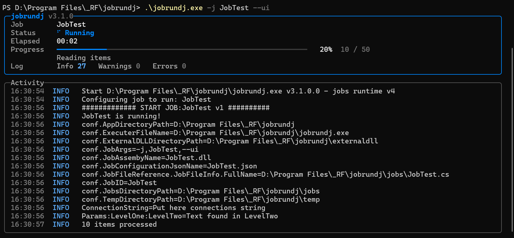
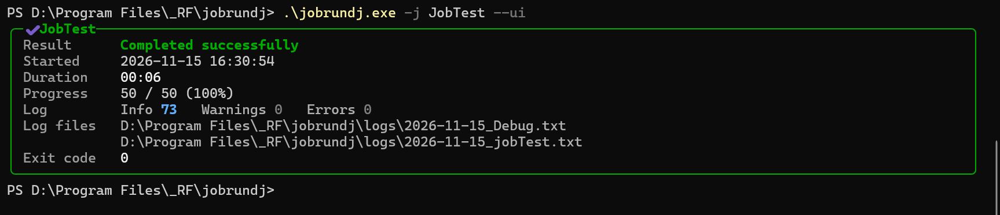
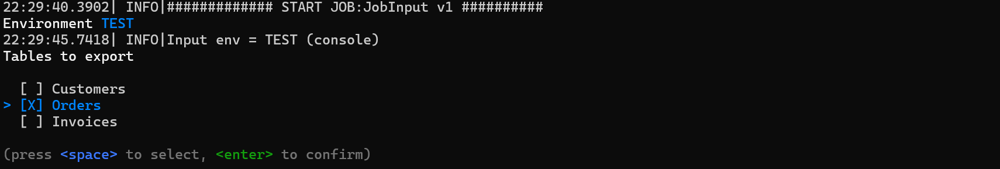
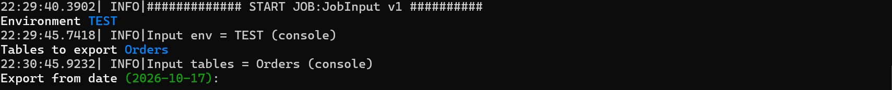

# jobrundj

[English](README.md) | [Italiano](README.it.md) | [Español](README.es.md) | **Français** | [Deutsch](README.de.md)

est un outil pour exécuter des scripts C#.

Il est écrit et fonctionne sur .NET 10 sous Windows, Linux et macOS.


- Les scripts sont appelés jobs. Chaque job est un fichier .cs enregistré dans le dossier .\jobs.
- Le job doit contenir une classe qui hérite de jobmodeldj.jobs.Job.
- Le code du script s'implémente en redéfinissant (override) la méthode Execute.
- Les autres assemblies dont dépend le job doivent être déclarées sur la première ligne, entre les balises jobrundjReferencedAssemblies.
- La variable l est un NLog.Logger.
- L'argument conf contient les références de configuration.
- On peut ajouter un fichier [NomDuJob].json pour enregistrer des configurations personnalisées (chaînes de connexion, etc.).
- Le dossier docs/JobExamples contient quelques jobs de test.

```c#
//<jobrundjReferencedAssemblies></jobrundjReferencedAssemblies>
using System;
using System.Threading;
using NLog;
using jobmodeldj.Model;

namespace jobmodeldj.jobs
{
    class JobTest : Job
    {
        public override int JobRuntimeVersion { get { return 4; } }
        public int Version { get { return 1; } }

        public override void Execute(JobConfiguration conf)
        {
            try
            {
                l.Info("{0} is running!", this.JobID);
                l.Info("conf.AppDirectoryPath={0}", conf.AppDirectoryPath);
                l.Info("conf.ExecuterFileName={0}", conf.ExecuterFileName);
                l.Info("conf.ExternalDLLDirectoryPath={0}", conf.ExternalDLLDirectoryPath);
                l.Info("conf.JobArgs={0}", string.Join(',',conf.JobArgs));
                l.Info("conf.JobAssembyName={0}", conf.JobAssembyName);
                l.Info("conf.JobConfigurationJsonName={0}", conf.JobConfigurationJsonName);
                l.Info("conf.JobFileReference.JobFileInfo.FullName={0}", conf.JobFileReference.JobFileInfo.FullName);
                l.Info("conf.JobID={0}", conf.JobID);
                l.Info("conf.JobsDirectoryPath={0}", conf.JobsDirectoryPath);
                l.Info("conf.TempDirectoryPath={0}", conf.TempDirectoryPath);
                l.Info("ConnectionString={0}", conf.Json?["ConnectionString"]);
                l.Info("Params:LevelOne:LevelTwo={0}", conf.Json?["Params:LevelOne:LevelTwo"]);

                // Démo de Progress : lancez "jobrundj -j JobTest --ui" pour voir la barre de progression.
                // Progress(courant, total, message) fait avancer la barre du tableau de bord et écrit
                // "Progress 25/50 (50%) ..." dans le log (au plus une fois par point de pourcentage ou toutes les 2 secondes).
                int total = 50;
                for (int i = 1; i <= total; i++)
                {
                    Thread.Sleep(100); // simule le travail sur un élément
                    Progress(i, total, i <= total / 2 ? "Reading items" : "Writing items");
                    if (i % 10 == 0) l.Info("{0} items processed", i);
                }

                //
                //TODO écrivez votre code ici..
                //
            }
            catch (Exception ex)
            {
                l.Error("errore {0} - {1}", JobID, ex.Message);
                throw ex;
            }
            finally
            {
                l.Info("end {0}", JobID);
            }
        }

    }
}
```

# jobrundj.exe / jobrundj.dll

jobrundj est l'application console qui exécute un job.

Sous Windows :

**`jobrundj.exe`** **`-j`** `NomDuJob`  

Sous Linux ou Mac OS :

**`dotnet jobrundj.dll`** **`-j`** `NomDuJob`  


# Tableau de bord en temps réel

Ajoutez `--ui` pour suivre l'exécution dans un tableau de bord coloré dans la console : état, temps écoulé, barre de progression, nombre d'avertissements et d'erreurs et derniers messages du log. À la fin, un résumé affiche le résultat, la durée, les avertissements et erreurs et les fichiers de log.

Sous Windows :

**`jobrundj.exe`** **`-j`** `NomDuJob` **`--ui`**

Sous Linux ou Mac OS :

**`dotnet jobrundj.dll`** **`-j`** `NomDuJob` **`--ui`**

Exécution de JobTest avec le tableau de bord en temps réel dans Windows Terminal (`jobrundj.exe -j JobTest --ui`), pendant l'exécution et à la fin :





La barre de progression apparaît quand le job appelle `Progress(courant, total, "message")`, par exemple `Progress(i, lignes.Count, "Export des lignes")` dans une boucle. `Progress` écrit aussi une ligne de log (`Progress 680/1000 (68%) Export des lignes`), au plus une fois par point de pourcentage ou toutes les 2 secondes : il peut donc être appelé à chaque élément.

`--ui` nécessite un terminal interactif (Windows Terminal, le Terminal de macOS, n'importe quel terminal Linux). Si la sortie est redirigée ou si le job est planifié, l'option est ignorée et jobrundj écrit le log dans la console comme d'habitude. Les fichiers de log sont toujours écrits.

Pour lancer un job d'un double clic, créez un raccourci sur le bureau avec `new-shortcut.ps1` (Windows) ou `new-shortcut.sh` (macOS / Linux), inclus dans la distribution : voir le [guide pour les développeurs de jobs](jobrundj/dist/DEVELOPER_GUIDE.md#desktop-shortcuts).


# Jobs interactifs

Un job peut demander des valeurs (texte, nombres, dates, confirmations, un ou plusieurs éléments d'une liste) avec `Prompt`, par exemple `Prompt.Choose("env", "Environnement", new[] { "DEV", "TEST", "PROD" })`. Ajoutez `-i` (`--interactive`) pour répondre aux questions dans la console ; le job continue ensuite et le log reprend normalement.

**`jobrundj.exe`** **`-j`** `JobInput` **`-i`**

Exécution du job d'exemple JobInput dans Windows Terminal : choix des tables à exporter, puis saisie d'une date (la valeur par défaut est indiquée entre parenthèses). Chaque réponse est écrite dans le log :





Chaque valeur peut aussi être passée en ligne de commande ou dans la section `"JobParams"` du fichier json du job : ces valeurs ne sont pas demandées, ainsi le même job s'exécute depuis un planificateur sans questions.

**`jobrundj.exe`** **`-j`** `JobInput` **`--param`** `env=TEST tables=Orders,Invoices`

`-i` désactive `--ui` et est ignoré quand l'entrée ou la sortie sont redirigées. Détails et exemples dans le [guide pour les développeurs de jobs](jobrundj/dist/DEVELOPER_GUIDE.md#asking-for-input).


# Déboguer des jobs dans Visual Studio Code

Le package de distribution contient un dossier `.vscode` prêt à l'emploi. Les instructions complètes (configurations de débogage, arguments des jobs, résolution des problèmes) se trouvent dans le [guide pour les développeurs de jobs](jobrundj/dist/DEVELOPER_GUIDE.md#debugging-in-vs-code).

1. Installez [VS Code](https://code.visualstudio.com/) et l'extension **C#** (`ms-dotnettools.csharp`).
2. Ouvrez dans VS Code le dossier de jobrundj (celui qui contient `jobrundj.exe` / `jobrundj.dll`).
3. Ouvrez le fichier du job dans `jobs`, placez des points d'arrêt et appuyez sur **F5** (configuration *Debug current job file*).

Autres configurations :

- *Debug current job file (with arguments)* : demande les arguments à passer au job.
- *Debug job by name* : demande le nom du job.
- *Attach to jobrundj* : lancez `jobrundj -j NomDuJob --debug` (il attend un débogueur), puis attachez-vous au processus.

Options de ligne de commande :

- `-j`, `--job` job à exécuter (obligatoire)
- `-d`, `--jobsdir` dossier contenant les jobs (par défaut : `jobs` à côté de l'exécutable)
- `--debug` compile le job avec les symboles de débogage et attend qu'un débogueur s'attache
- `--ui` affiche un tableau de bord en temps réel avec la progression et un résumé à la fin (voir [Tableau de bord en temps réel](#tableau-de-bord-en-temps-réel))
- `-i`, `--interactive` demande dans la console les valeurs du job non passées avec `--param` (voir [Jobs interactifs](#jobs-interactifs))
- `--param key=value ...` valeurs d'entrée pour le job
- `--pause` attend une touche avant de fermer la fenêtre (console interactive uniquement), utile pour les raccourcis sur le bureau

`jobs/jobs.csproj` sert uniquement à VS Code pour IntelliSense (nécessite le .NET SDK) ; il n'est pas nécessaire pour exécuter les jobs.

# Installation (exécution des jobs uniquement)

Cette section s'adresse à ceux qui doivent uniquement **exécuter** des jobs, par exemple sur un serveur. Ni VS Code ni le .NET SDK ne sont nécessaires.

1. Installez le [.NET 10 Runtime](https://dotnet.microsoft.com/download/dotnet/10.0) (le *.NET Runtime* suffit).
2. Téléchargez `jobrundj-<version>.zip` depuis la [page des releases](https://github.com/renzfe/jobrundj/releases) et décompressez-le. Déplacez le contenu du dossier `jobrundj-<version>` dans le dossier d'installation, par exemple `C:\jobrundj` ou `/opt/jobrundj`.
3. Copiez dans le dossier `jobs` les fichiers des jobs que vous avez reçus (`MonJob.cs` et, s'il existe, `MonJob.json`). Copiez dans `externaldll` les éventuelles .dll supplémentaires nécessaires aux jobs.
4. Exécutez le job :
   - Windows : `C:\jobrundj\jobrundj.exe -j MonJob`
   - Linux / macOS : `dotnet /opt/jobrundj/jobrundj.dll -j MonJob`
5. Vérifiez le résultat : code de sortie `0` = succès, `1` = erreur. Les logs sont écrits dans le dossier `logs` ; leur format et leur destination se modifient dans `NLog.config`.

Pour exécuter un job automatiquement, planifiez la commande :

- Windows (Planificateur de tâches), tous les jours à 06:00 :
  `schtasks /Create /TN "jobrundj MonJob" /TR "C:\jobrundj\jobrundj.exe -j MonJob" /SC DAILY /ST 06:00`
- Linux / macOS (crontab), tous les jours à 06:00 :
  `0 6 * * * dotnet /opt/jobrundj/jobrundj.dll -j MonJob`

Le dossier `.vscode`, le fichier `jobs/jobs.csproj`, le guide `DEVELOPER_GUIDE.md` et les fichiers de contexte pour l'IA `AGENTS.md` / `CLAUDE.md` ne servent qu'au développement des jobs et peuvent être ignorés.

**Mise à jour vers une nouvelle version :** copiez le contenu du nouveau dossier `jobrundj-<version>` par-dessus le dossier d'installation. Vos jobs dans `jobs` et les .dll dans `externaldll` sont conservés ; si vous avez modifié `NLog.config`, ne l'écrasez pas.

# Développement des jobs

🛠️ **Si vous écrivez ou déboguez des jobs, suivez le [guide pour les développeurs de jobs](jobrundj/dist/DEVELOPER_GUIDE.md)** (en anglais). Il explique comment configurer VS Code, écrire un job, le déboguer pas à pas et contient un exemple complet (un job qui exporte le résultat d'une requête sur une base de données dans un fichier CSV). Le même guide est inclus sous le nom `DEVELOPER_GUIDE.md` dans le package de distribution.

# Notes de version

## v3.2.0 Date de publication : 2026-11-16

- Option `-i` / `--interactive` : le job peut demander des valeurs dans la console (texte, nombres, dates, confirmations, un ou plusieurs éléments d'une liste) ; le job continue ensuite avec le log habituel
- `Prompt` dans `Job` (`conf.Prompt`) : valeurs d'entrée depuis `--param cle=valeur`, depuis la section `"JobParams"` du fichier json du job, depuis la console avec `-i` ou depuis une valeur par défaut
- Option `--param cle=valeur` pour passer les valeurs d'entrée sans questions (par exemple pour les exécutions planifiées)
- Option `-Interactive` / `--interactive` dans `new-shortcut.ps1` / `new-shortcut.sh`
- Job d'exemple `JobInput`

## v3.1.0 Date de publication : 2026-11-15

- Option `--ui` : tableau de bord en temps réel dans la console (progression, compteurs du log, derniers messages) et résumé à la fin
- Méthode `Progress(courant, total, message)` dans `Job` pour indiquer la progression du job
- Option `--pause` : attend une touche avant de fermer la fenêtre
- Scripts `new-shortcut.ps1` / `new-shortcut.sh` pour créer des raccourcis sur le bureau qui lancent un job avec le tableau de bord

## v3.0.0 Date de publication : 2026-11-15

- Débogage des jobs dans Visual Studio Code (points d'arrêt dans les fichiers .cs des jobs)
- Nouvelles options de ligne de commande : `-d`/`--jobsdir` et `--debug`
- Le package de distribution inclut les configurations de débogage `.vscode`, `jobs/jobs.csproj` pour IntelliSense et un guide pour les développeurs de jobs
- Script `build-dist.ps1` pour créer le package de distribution

## v2.3.0 Date de publication : 2026-11-14

- Mise à jour vers dotnet 10.0

## v2.1.0 Date de publication : 2023-01-07

- Introduction de la Version du job pour versionner chaque job

## v2.0.0 Date de publication : 2023-12-29

- Mise à jour vers dotnet 8.0
- Version du runtime des jobs v4


## v1.5.0 Date de publication : 2023-04-25

- Mise à jour vers dotnet 7.0
- Version du runtime des jobs v3


## v1.3.0 Date de publication : 2022-11-13

- Étendez la classe Options pour implémenter des arguments spécifiques dans votre job


## v1.1.0 Date de publication : 2022-11-06

- Première version stable.


---
Le projet est distribué sous licence [MIT](LICENSE).
