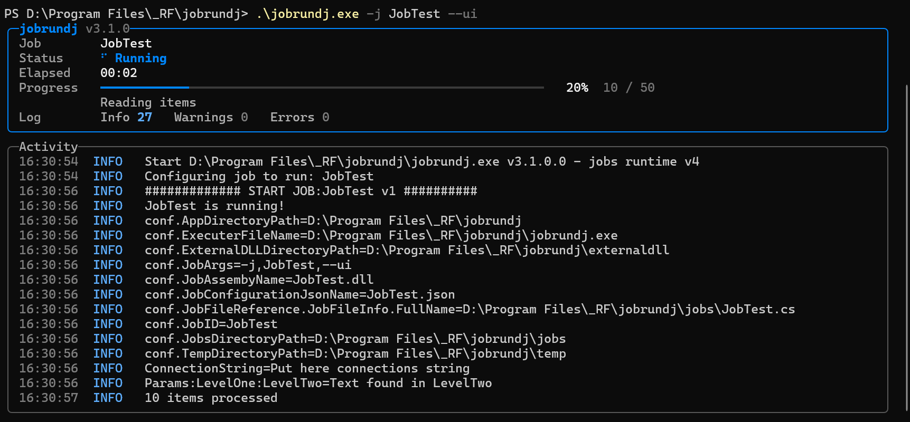
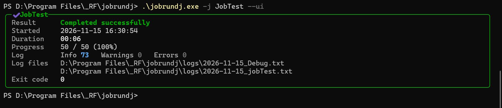

# jobrundj

[English](README.md) | **Italiano** | [Español](README.es.md) | [Français](README.fr.md) | [Deutsch](README.de.md)

è uno strumento per eseguire script C#.

È scritto e gira su .NET 10 su Windows, Linux e macOS.


- Gli script si chiamano job. Ogni job è un file .cs salvato nella cartella .\jobs.
- Il job deve contenere una classe che estende jobmodeldj.jobs.Job.
- Il codice dello script va implementato facendo l'override del metodo Execute.
- Eventuali altri assembly da cui dipende il job vanno dichiarati nella prima riga, tra i tag jobrundjReferencedAssemblies.
- La variabile l è un NLog.Logger.
- L'argomento conf contiene i riferimenti di configurazione.
- Si può aggiungere un file [NomeJob].json per salvare configurazioni personalizzate (stringhe di connessione, ecc.).
- La cartella docs/JobExamples contiene alcuni job di prova.

```c#
//<jobrundjReferencedAssemblies></jobrundjReferencedAssemblies>
using System;
using System.Threading;
using NLog;
using jobmodeldj.Model;

namespace jobmodeldj.jobs
{
    class JobTest : Job
    {
        public override int JobRuntimeVersion { get { return 4; } }
        public int Version { get { return 1; } }

        public override void Execute(JobConfiguration conf)
        {
            try
            {
                l.Info("{0} is running!", this.JobID);
                l.Info("conf.AppDirectoryPath={0}", conf.AppDirectoryPath);
                l.Info("conf.ExecuterFileName={0}", conf.ExecuterFileName);
                l.Info("conf.ExternalDLLDirectoryPath={0}", conf.ExternalDLLDirectoryPath);
                l.Info("conf.JobArgs={0}", string.Join(',',conf.JobArgs));
                l.Info("conf.JobAssembyName={0}", conf.JobAssembyName);
                l.Info("conf.JobConfigurationJsonName={0}", conf.JobConfigurationJsonName);
                l.Info("conf.JobFileReference.JobFileInfo.FullName={0}", conf.JobFileReference.JobFileInfo.FullName);
                l.Info("conf.JobID={0}", conf.JobID);
                l.Info("conf.JobsDirectoryPath={0}", conf.JobsDirectoryPath);
                l.Info("conf.TempDirectoryPath={0}", conf.TempDirectoryPath);
                l.Info("ConnectionString={0}", conf.Json?["ConnectionString"]);
                l.Info("Params:LevelOne:LevelTwo={0}", conf.Json?["Params:LevelOne:LevelTwo"]);

                // Demo di Progress: esegui "jobrundj -j JobTest --ui" per vedere la barra di avanzamento.
                // Progress(corrente, totale, messaggio) muove la barra della dashboard e scrive
                // "Progress 25/50 (50%) ..." nel log (al massimo una volta per punto percentuale o ogni 2 secondi).
                int total = 50;
                for (int i = 1; i <= total; i++)
                {
                    Thread.Sleep(100); // simula il lavoro su un elemento
                    Progress(i, total, i <= total / 2 ? "Reading items" : "Writing items");
                    if (i % 10 == 0) l.Info("{0} items processed", i);
                }

                //
                //TODO scrivi qui il tuo codice..
                //
            }
            catch (Exception ex)
            {
                l.Error("errore {0} - {1}", JobID, ex.Message);
                throw ex;
            }
            finally
            {
                l.Info("end {0}", JobID);
            }
        }

    }
}
```

Esecuzione di JobTest con la dashboard in tempo reale in Windows Terminal (`jobrundj.exe -j JobTest --ui`), durante l'esecuzione e alla fine:





# jobrundj.exe / jobrundj.dll

jobrundj è l'applicazione console che esegue un job.

Su Windows:

**`jobrundj.exe`** **`-j`** `NomeJob`  

Su Linux o Mac OS:

**`dotnet jobrundj.dll`** **`-j`** `NomeJob`  


# Dashboard in tempo reale

Aggiungi `--ui` per seguire l'esecuzione in una dashboard colorata nella console: stato, tempo trascorso, barra di avanzamento, numero di warning ed errori e gli ultimi messaggi di log. Alla fine un riepilogo mostra esito, durata, warning ed errori e i file di log.

Su Windows:

**`jobrundj.exe`** **`-j`** `NomeJob` **`--ui`**

Su Linux o Mac OS:

**`dotnet jobrundj.dll`** **`-j`** `NomeJob` **`--ui`**

La barra di avanzamento compare quando il job chiama `Progress(corrente, totale, "messaggio")`, per esempio `Progress(i, righe.Count, "Esportazione righe")` dentro un ciclo. `Progress` scrive anche una riga di log (`Progress 680/1000 (68%) Esportazione righe`), al massimo una volta per punto percentuale o ogni 2 secondi, quindi può essere chiamato a ogni elemento.

`--ui` richiede un terminale interattivo (Windows Terminal, il Terminale di macOS, qualsiasi terminale Linux). Se l'output è rediretto o il job è schedulato l'opzione viene ignorata e jobrundj scrive il log sulla console come sempre. I file di log vengono scritti in ogni caso.

Per avviare un job con un doppio clic crea un collegamento sul desktop con `new-shortcut.ps1` (Windows) o `new-shortcut.sh` (macOS / Linux), inclusi nella distribuzione: vedi la [guida per gli sviluppatori dei job](jobrundj/dist/DEVELOPER_GUIDE.md#desktop-shortcuts).


# Debug dei job in Visual Studio Code

Il pacchetto di distribuzione contiene una cartella `.vscode` già pronta. Le istruzioni complete (configurazioni di debug, argomenti dei job, risoluzione dei problemi) sono nella [guida per gli sviluppatori dei job](jobrundj/dist/DEVELOPER_GUIDE.md#debugging-in-vs-code).

1. Installa [VS Code](https://code.visualstudio.com/) e l'estensione **C#** (`ms-dotnettools.csharp`).
2. Apri in VS Code la cartella di jobrundj (quella che contiene `jobrundj.exe` / `jobrundj.dll`).
3. Apri il file del job in `jobs`, imposta i breakpoint e premi **F5** (configurazione *Debug current job file*).

Altre configurazioni:

- *Debug current job file (with arguments)*: chiede gli argomenti da passare al job.
- *Debug job by name*: chiede il nome del job.
- *Attach to jobrundj*: avvia `jobrundj -j NomeJob --debug` (resta in attesa del debugger), poi collegati al processo.

Opzioni da linea di comando:

- `-j`, `--job` job da eseguire (obbligatoria)
- `-d`, `--jobsdir` cartella che contiene i job (predefinita: `jobs` accanto all'eseguibile)
- `--debug` compila il job con i simboli di debug e attende che si colleghi un debugger
- `--ui` mostra una dashboard in tempo reale con l'avanzamento e un riepilogo finale (vedi [Dashboard in tempo reale](#dashboard-in-tempo-reale))
- `--pause` attende un tasto prima di chiudere la finestra (solo console interattiva), utile per i collegamenti sul desktop

`jobs/jobs.csproj` serve solo a VS Code per l'IntelliSense (richiede il .NET SDK); non è necessario per eseguire i job.

# Installazione (solo esecuzione dei job)

Questa sezione è per chi deve solo **eseguire** i job, per esempio su un server. Non servono né VS Code né il .NET SDK.

1. Installa il [.NET 10 Runtime](https://dotnet.microsoft.com/download/dotnet/10.0) (basta il *.NET Runtime*).
2. Scarica `jobrundj-<versione>.zip` dalla [pagina delle release](https://github.com/renzfe/jobrundj/releases) ed estrailo. Sposta il contenuto della cartella `jobrundj-<versione>` nella cartella di installazione, per esempio `C:\jobrundj` o `/opt/jobrundj`.
3. Copia nella cartella `jobs` i file dei job che hai ricevuto (`MioJob.cs` e, se presente, `MioJob.json`). Copia in `externaldll` le eventuali .dll aggiuntive richieste dai job.
4. Esegui il job:
   - Windows: `C:\jobrundj\jobrundj.exe -j MioJob`
   - Linux / macOS: `dotnet /opt/jobrundj/jobrundj.dll -j MioJob`
5. Controlla il risultato: codice di uscita `0` = successo, `1` = errore. I log vengono scritti nella cartella `logs`; formato e destinazione si possono cambiare in `NLog.config`.

Per eseguire un job in automatico, pianifica il comando:

- Windows (Utilità di pianificazione), ogni giorno alle 06:00:
  `schtasks /Create /TN "jobrundj MioJob" /TR "C:\jobrundj\jobrundj.exe -j MioJob" /SC DAILY /ST 06:00`
- Linux / macOS (crontab), ogni giorno alle 06:00:
  `0 6 * * * dotnet /opt/jobrundj/jobrundj.dll -j MioJob`

La cartella `.vscode`, il file `jobs/jobs.csproj`, la guida `DEVELOPER_GUIDE.md` e i file di contesto per l'AI `AGENTS.md` / `CLAUDE.md` servono solo per sviluppare i job e si possono ignorare.

**Aggiornamento a una nuova versione:** copia il contenuto della nuova cartella `jobrundj-<versione>` sopra la cartella di installazione. I tuoi job in `jobs` e le .dll in `externaldll` vengono mantenuti; se hai modificato `NLog.config`, non sovrascriverlo.

# Sviluppo dei job

🛠️ **Se scrivi o debugghi job, segui la [guida per gli sviluppatori dei job](jobrundj/dist/DEVELOPER_GUIDE.md)** (in inglese). Spiega come configurare VS Code, scrivere un job, debuggarlo passo passo e contiene un esempio completo (un job che esporta il risultato di una query su database in un file CSV). La stessa guida è inclusa come `DEVELOPER_GUIDE.md` nel pacchetto di distribuzione.

# Note di rilascio

## v3.1.0 Data di rilascio: 2026-11-15

- Opzione `--ui`: dashboard in tempo reale nella console (avanzamento, contatori del log, ultimi messaggi) e riepilogo finale
- Metodo `Progress(corrente, totale, messaggio)` in `Job` per comunicare l'avanzamento del job
- Opzione `--pause`: attende un tasto prima di chiudere la finestra
- Script `new-shortcut.ps1` / `new-shortcut.sh` per creare collegamenti sul desktop che avviano un job con la dashboard

## v3.0.0 Data di rilascio: 2026-11-15

- Debug dei job in Visual Studio Code (breakpoint nei file .cs dei job)
- Nuove opzioni da linea di comando: `-d`/`--jobsdir` e `--debug`
- Il pacchetto di distribuzione include le configurazioni di debug `.vscode`, `jobs/jobs.csproj` per l'IntelliSense e una guida per gli sviluppatori dei job
- Script `build-dist.ps1` per creare il pacchetto di distribuzione

## v2.3.0 Data di rilascio: 2026-11-14

- Aggiornamento a dotnet 10.0

## v2.1.0 Data di rilascio: 2023-01-07

- Introdotta la Version del job per versionare i singoli job

## v2.0.0 Data di rilascio: 2023-12-29

- Aggiornamento a dotnet 8.0
- Versione del runtime dei job v4


## v1.5.0 Data di rilascio: 2023-04-25

- Aggiornamento a dotnet 7.0
- Versione del runtime dei job v3


## v1.3.0 Data di rilascio: 2022-11-13

- Estendi la classe Options per implementare argomenti specifici nel tuo job


## v1.1.0 Data di rilascio: 2022-11-06

- Prima versione stabile.


---
Il progetto è distribuito con licenza [MIT](LICENSE).
