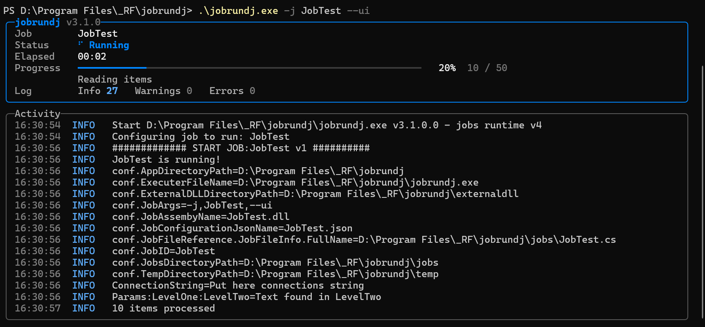
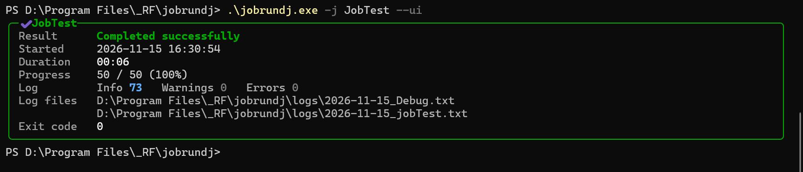

# jobrundj

**English** | [Italiano](README.it.md) | [Español](README.es.md) | [Français](README.fr.md) | [Deutsch](README.de.md)

is a tool to run C# scripts.  

It is written and runs on .NET 10.0 Framework on Windows, Linux and Mac OS.


- Scripts are called jobs. Every job is a .cs file saved in .\jobs folder.  
- The job must contain a class that extends jobmodeldj.jobs.Job.  
- The script code must be implemented overriding the Execute method.  
- Any other assembly dependency must be declare in the first line between jobrundjReferencedAssemblies tags
- Variable l is a NLog.Logger
- The argument conf contains configuration references
- It can be add a [JobName].json file to save custom configurations (connection strings, etc)
- The docs/JobExamples folder contains some job for test

```c#
//<jobrundjReferencedAssemblies></jobrundjReferencedAssemblies>
using System;
using System.Threading;
using NLog;
using jobmodeldj.Model;

namespace jobmodeldj.jobs
{
    class JobTest : Job
    {
        public override int JobRuntimeVersion { get { return 4; } }
        public int Version { get { return 1; } }

        public override void Execute(JobConfiguration conf)
        {
            try
            {
                l.Info("{0} is running!", this.JobID);
                l.Info("conf.AppDirectoryPath={0}", conf.AppDirectoryPath);
                l.Info("conf.ExecuterFileName={0}", conf.ExecuterFileName);
                l.Info("conf.ExternalDLLDirectoryPath={0}", conf.ExternalDLLDirectoryPath);
                l.Info("conf.JobArgs={0}", string.Join(',',conf.JobArgs));
                l.Info("conf.JobAssembyName={0}", conf.JobAssembyName);
                l.Info("conf.JobConfigurationJsonName={0}", conf.JobConfigurationJsonName);
                l.Info("conf.JobFileReference.JobFileInfo.FullName={0}", conf.JobFileReference.JobFileInfo.FullName);
                l.Info("conf.JobID={0}", conf.JobID);
                l.Info("conf.JobsDirectoryPath={0}", conf.JobsDirectoryPath);
                l.Info("conf.TempDirectoryPath={0}", conf.TempDirectoryPath);
                l.Info("ConnectionString={0}", conf.Json?["ConnectionString"]);
                l.Info("Params:LevelOne:LevelTwo={0}", conf.Json?["Params:LevelOne:LevelTwo"]);

                // Progress demo: run "jobrundj -j JobTest --ui" to see the progress bar.
                // Progress(current, total, message) moves the bar of the dashboard and writes
                // "Progress 25/50 (50%) ..." in the log (at most once per percentage point or every 2 seconds).
                int total = 50;
                for (int i = 1; i <= total; i++)
                {
                    Thread.Sleep(100); // simulates the work on one item
                    Progress(i, total, i <= total / 2 ? "Reading items" : "Writing items");
                    if (i % 10 == 0) l.Info("{0} items processed", i);
                }

                //
                //TODO write your code here..
                //
            }
            catch (Exception ex)
            {
                l.Error("errore {0} - {1}", JobID, ex.Message);
                throw ex;
            }
            finally
            {
                l.Info("end {0}", JobID);
            }
        }

    }
}
```

Running JobTest with the live dashboard in Windows Terminal (`jobrundj.exe -j JobTest --ui`), while the job runs and at the end:





# jobrundj.exe / jobrundj.dll

jobrundj is the Console Application to execute a job.

On Windows OS:

**`jobrundj.exe`** **`-j`** `JobName`  

On Linux or Mac OS:

**`dotnet jobrundj.dll`** **`-j`** `JobName`  


# Live dashboard

Add `--ui` to follow the run in a colored console dashboard: status, elapsed time, progress bar, number of warnings and errors and the latest log messages. At the end a summary shows the result, the duration, the warnings and errors and the log files.

On Windows OS:

**`jobrundj.exe`** **`-j`** `JobName` **`--ui`**

On Linux or Mac OS:

**`dotnet jobrundj.dll`** **`-j`** `JobName` **`--ui`**

The progress bar appears when the job calls `Progress(current, total, "message")`, for example `Progress(i, rows.Count, "Exporting rows")` inside a loop. `Progress` also writes a log line (`Progress 680/1000 (68%) Exporting rows`), at most once per percentage point or every 2 seconds, so it can be called on every item.

`--ui` needs an interactive terminal (Windows Terminal, the macOS Terminal, any Linux terminal). When the output is redirected or the job is scheduled the option is ignored and jobrundj logs to the console as usual. The log files are always written.

To start a job with a double click, create a desktop shortcut with `new-shortcut.ps1` (Windows) or `new-shortcut.sh` (macOS / Linux), included in the distribution: see the [guide for job developers](jobrundj/dist/DEVELOPER_GUIDE.md#desktop-shortcuts).


# Debugging jobs in Visual Studio Code

The distribution contains a ready-to-use `.vscode` folder. Full instructions (debug configurations, job arguments, troubleshooting) are in the [guide for job developers](jobrundj/dist/DEVELOPER_GUIDE.md#debugging-in-vs-code).

1. Install [VS Code](https://code.visualstudio.com/) and the **C#** extension (`ms-dotnettools.csharp`).
2. Open the jobrundj folder (the one containing `jobrundj.exe` / `jobrundj.dll`) in VS Code.
3. Open your job file in `jobs`, set breakpoints and press **F5** (configuration *Debug current job file*).

Other configurations:

- *Debug current job file (with arguments)*: asks for the job arguments.
- *Debug job by name*: asks for the job name.
- *Attach to jobrundj*: start `jobrundj -j JobName --debug` (it waits for a debugger), then attach to the process.

Command line options:

- `-j`, `--job` job to run (required)
- `-d`, `--jobsdir` folder containing the jobs (default: `jobs` next to the executable)
- `--debug` compile the job with debug symbols and wait for a debugger to attach
- `--ui` show a live dashboard with the progress and a summary at the end (see [Live dashboard](#live-dashboard))
- `--pause` wait for a key before closing the window (interactive console only), useful for desktop shortcuts

`jobs/jobs.csproj` is used only by VS Code for IntelliSense (requires the .NET SDK); it is not needed to run the jobs.

# Installation (running jobs only)

This section is for those who only **run** jobs, for example on a server. You don't need VS Code or the .NET SDK.

1. Install the [.NET 10 Runtime](https://dotnet.microsoft.com/download/dotnet/10.0) (the *.NET Runtime* is enough).
2. Download `jobrundj-<version>.zip` from the [releases page](https://github.com/renzfe/jobrundj/releases) and extract it. Move the content of the `jobrundj-<version>` folder to the installation folder, for example `C:\jobrundj` or `/opt/jobrundj`.
3. Copy into the `jobs` folder the job files you received (`MyJob.cs` and, if present, `MyJob.json`). Copy any extra .dll required by the jobs into `externaldll`.
4. Run the job:
   - Windows: `C:\jobrundj\jobrundj.exe -j MyJob`
   - Linux / macOS: `dotnet /opt/jobrundj/jobrundj.dll -j MyJob`
5. Check the result: exit code `0` = success, `1` = error. Logs are written in the `logs` folder; their format and destination can be changed in `NLog.config`.

To run a job automatically, schedule the command:

- Windows (Task Scheduler), every day at 06:00:
  `schtasks /Create /TN "jobrundj MyJob" /TR "C:\jobrundj\jobrundj.exe -j MyJob" /SC DAILY /ST 06:00`
- Linux / macOS (crontab), every day at 06:00:
  `0 6 * * * dotnet /opt/jobrundj/jobrundj.dll -j MyJob`

The `.vscode` folder, `jobs/jobs.csproj`, the guide `DEVELOPER_GUIDE.md` and the AI context files `AGENTS.md` / `CLAUDE.md` are only needed to develop jobs and can be ignored.

**Updating to a new version:** copy the content of the new `jobrundj-<version>` folder over the installation folder. Your jobs in `jobs` and the .dll in `externaldll` are kept; if you changed `NLog.config`, don't overwrite it.

# Developing jobs

🛠️ **If you write or debug jobs, follow the [guide for job developers](jobrundj/dist/DEVELOPER_GUIDE.md).** It explains how to set up VS Code, write a job, debug it step by step and contains a complete example (a job that exports a database query to a CSV file). The same guide is included as `DEVELOPER_GUIDE.md` in the distribution package.

# Release notes

## v3.1.0 Release date: 2026-11-15

- `--ui` option: live console dashboard (progress, log counters, latest messages) and a summary at the end
- `Progress(current, total, message)` method in `Job` to report the job progress
- `--pause` option: waits for a key before closing the window
- `new-shortcut.ps1` / `new-shortcut.sh` scripts to create desktop shortcuts that run a job with the dashboard

## v3.0.0 Release date: 2026-11-15

- Debug jobs in Visual Studio Code (breakpoints in the job .cs files)
- New command line options: `-d`/`--jobsdir` and `--debug`
- The distribution includes `.vscode` debug configurations, `jobs/jobs.csproj` for IntelliSense and a guide for job developers
- `build-dist.ps1` script to create the distribution package

## v2.3.0 Release date: 2026-11-14

- Upgrade to dotnet 10.0 

## v2.1.0 Release date: 2023-01-07

- Intrduce job Version to version specific job 

## v2.0.0 Release date: 2023-12-29

- Upgrade to dotnet 8.0 
- Runtime jobfile version v4


## v1.5.0 Release date: 2023-04-25

- Upgrade to dotnet 7.0 
- Runtime jobfile version v3


## v1.3.0 Release date: 2022-11-13

- Extend Options class to implement specific argument in your job


## v1.1.0 Release date: 2022-11-06

- This is the first stable release.


---
The license of the project is the [MIT](LICENSE).
